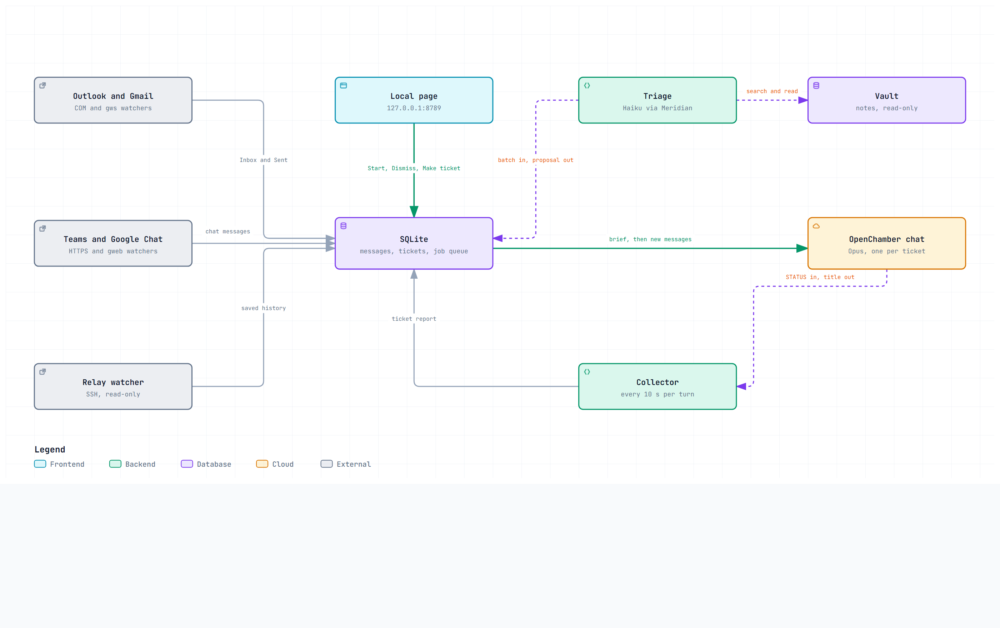
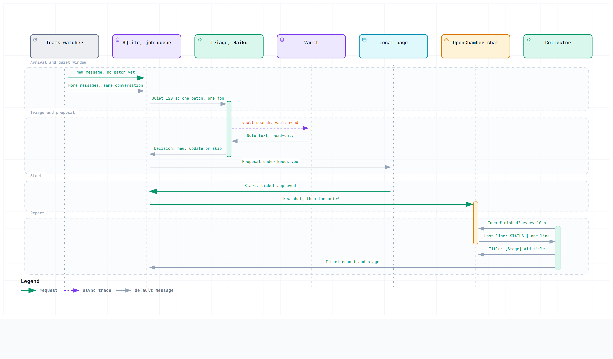

# Everflow: from message to ticket and chat

How Everflow collects mail and chat messages, proposes tickets on a local page, and runs an approved ticket in an OpenChamber chat.

## Overview

Everflow reads Outlook, Teams, the Teams relay, Google Chat through gweb and Gmail through gws. It groups new messages by conversation and asks a small model whether the group needs work. When it does, a ticket proposal appears on a local page. Nothing else happens until Start is pressed on that ticket.

Start opens one OpenChamber chat for the ticket and sends it a brief. The chat works under the normal rules of the assistant, and ends every turn with a STATUS line. Everflow reads that line back onto the ticket and into the chat title.

Everflow never sends anything. It has no mail or chat send transport, writes no read receipts, sends no auto-replies and changes no read state at the source. It never starts, focuses or closes Outlook, Teams or providers. Google Chat can optionally bootstrap authentication from its saved Chrome profile, minimized and without prompts. Outward-facing text is approved inside the chat, never on the page.

## How the parts connect

Each watcher is a child process that prints one JSON line per message. The daemon stores the lines in SQLite, and every later step runs as a job from the queue in the same database. The page reads and writes the same database through its own local server.

## One message, from arrival to report

Time runs from top to bottom in four phases. A message waits without a batch until its conversation has been quiet for the window of its source, then all new messages of that conversation become one batch. The chat phase starts only after Start.

## Models and prompts

| Step | Model | Prompt | What the model sees |
|---|---|---|---|
| Triage | Haiku | `kb-agent.ts` lines 91 to 96 | The new messages of one conversation since it went quiet, the 40 earlier messages before them with send times, the current time, its title, the inferred clients, the candidate tickets with title and summary, the ticket already linked, past Dismiss reasons, and Vault notes on request |
| Chat brief | Opus | `chat.ts` lines 48 to 53, 123 to 134 and 136 to 160 | The ticket fields, the note given at approval, and every stored message of the conversations linked to the ticket |
| New messages | Opus, same chat | `chat.ts` lines 180 to 186 | Only the new batches, plus own replies not yet sent to the chat |
| Recovery | Opus, same chat | `chat.ts` lines 465 to 472 | The error, the original request quoted, and own replies since then |

The files are in `src/core/`. Triage runs `claude-haiku-5-5` through the provider `meridian-everbright`, and through `meridian-notarify` when the first is unavailable. Its input is built in `kb-agent.ts` lines 323 to 327 and `tickets.ts` lines 116 to 122 and 306 to 314, and the Vault is reached only through the tools `vault_search` and `vault_read`. Triage calls Meridian directly, without OpenChamber, so it does not load the normal instructions; the `[vault] guide` text in `config.toml` tells it how the Vault is laid out. Search covers the whole Vault, numbered folders first, and a note matches when it contains every word of the query. The chats run `meridian-everbright/claude-opus-5-5` through OpenChamber.

Triage decides on the new messages, the ones that arrived in that conversation since the last batch. With them it gets the latest 40 earlier messages of the same conversation, oldest first, each with its send time, sender, whether it is an own reply, and text cut at 2,000 characters. It also gets the current time, so it can tell an old request from a new one and see whether a later own reply already answered it. `[triage] history_messages` in `config.toml` sets the count, from 0 to 100. The chat brief is the step that sees the whole stored history of the ticket.

Triage returns one JSON decision: `new`, `update` or `skip`, with title, client, summary, ask, proposal, Vault paths and a confidence. It attaches the batch to an existing ticket only with a confidence of 0.75 or more; below that the ticket becomes a new proposal with the old one as context. The prompts mark source messages and Vault notes as untrusted data.

## Sources

| Source | How it reads | How often | What it covers |
|---|---|---|---|
| Outlook | COM against a Classic Outlook that is already open. The new Outlook is not supported | Every 60 seconds | Inbox and Sent of every configured account, mail and meeting items, body up to 50,000 characters |
| Teams | HTTPS GET to the Teams chat service, with the tokens of the signed-in local Teams profile | Every 30 seconds | Every account found in the profile, all chats except system views such as call logs and notifications |
| Teams relay | `sqlite3 -readonly` over SSH on the relay host, nothing installed there | Every 30 seconds | Saved history of the active relay accounts of one owner, text up to 2,000 characters |
| Google Chat | Installed gweb, saved web session, HTTP renewal first; optional minimized-profile fallback | Every 30 seconds | Returned spaces and DMs, newest 200 topics, capped replies, own replies and attachment/link metadata |
| Gmail | Installed gws, existing Gmail authentication, GET only | Every 30 seconds by default, 60 in example config | Inbox and Sent, paginated, MIME body up to 50,000 characters, attachment names and sizes |

- Outlook, Teams and Gmail overlap by 2 minutes. Relay replays its initial floor. Google Chat retains its floor and rereads returned recent topics; it cannot prove complete history.
- An expired Teams token is refreshed from the same profile. Teams is never restarted, and TLS is always verified.
- A line a watcher cannot parse goes to quarantine, and that source stops advancing until the line is replayed.
- A batch made only of own replies starts no triage. It is kept as context for the next chat turn of its ticket.
- Google sources require an explicit account. Gmail verifies its authenticated email; Google Chat verifies its configured Google user id on each conversation read. A mismatch stops that scan.
- Google Chat first retries rejected authentication through real HTTP cookie renewal. `browser_refresh = true` explicitly permits saved-profile fallback, minimized and without sign-in prompts. Otherwise Chrome is never opened. Older binaries fail on unsupported flags before session access. Revoked or signed-out sessions remain failures; permanent authentication is not promised.
- Google Chat caps read replies at 20 and unread replies at 100 per topic. Topic and conversation limits can omit history; health reports `recent-topics`, never full coverage.
- Neither Google watcher downloads attachment binaries or changes source labels/read state. CLI children have a 60-second deadline, 240 seconds for opted-in Chat bootstrap, and a 16 MiB output ceiling.

## Timings

All values are the defaults in `src/core/config.ts`; the running instance does not change them.

| What | Value |
|---|---|
| Quiet window before a batch | Outlook and Gmail 300 s; Teams, relay and Google Chat 120 s |
| Scheduling and collect check | Every 10 s |
| Page refresh | Every 10 s |
| Sync of chat reports | Every 300 s |
| Archive of an idle chat | After 24 h without activity or pending input, checked every 300 s |
| Reopen of a done ticket by new messages | Within 2 days of closing |
| Purge of message text | After 30 days, skipped batches with no ticket only, once a day |
| Job lease | 120 s, renewed every 30 s |
| Retry backoff | 10 s doubling to 1,800 s, 20% jitter |
| Attempts before parking | 5, for unknown errors |
| Recovery turns per failed chat turn | 2 |
| Health shown as failing | After 3 errors in a row |
| Triage budget | 8 tool calls and 120 s, repair turn included |
| Earlier messages sent to triage | 40, text cut at 2,000 characters |
| OpenChamber request timeout | 30 s |

## Rules

- Start approves a proposal. Open chat with note approves it too, and the note becomes the instruction quoted in the brief. Both need tickets and chats switched on.
- Approval creates one chat named `[Working] #<id> <title>`, in the folder of the ticket's client (`[clients.<name>] directory`), or in `[opencode] directory` when the ticket has no client or the client has no folder. After each turn the chat is renamed `[<stage>] #<id> <title>`, with the stage `Needs you`, `Working`, `Waiting on them`, `Idle`, `Done` or `Failed`.
- The last line of every turn must read `STATUS: <working|needs_you|waiting_them|done> | <one line>`. The brief defines each value. `done` closes the ticket. `blocked` is no longer offered but is still parsed as `Needs you`, for sessions opened before the change. A turn without a valid STATUS line parks its job.
- Dismiss closes a ticket with an optional reason. The reasons are passed to every later triage. The same dialog can mute the ticket's chat.
- Done closes a ticket that was handled by hand, with an optional note. It is not a Dismiss and is not passed to triage as negative feedback. New messages in its conversation within 2 days reopen it.
- During the trial every chat brief asks the chat to report a failing or missing tool in the turn and to append one line to `99_Inbox/everflow-tool-issues.md` in the Vault.
- Mute keeps a chat out of triage for 8 hours, 1 day, 1 week or until unmuted, from a Skipped batch or from Dismiss. Its new messages land under Skipped as `Muted`. Muted chats are listed on the page with Unmute.
- Make ticket turns a skipped, backlog or muted batch into a ticket, or adds it to the ticket the conversation already belongs to. It does not approve the ticket. On a muted batch it also ends the mute.
- `accounts = [...]` under a source keeps only those receiving accounts; messages of the others are dropped before storage and the page shows them as `off`. No list means every account. The list is read at start.
- New messages on an approved ticket go to the same chat. If a turn is still running, they wait and go in the next turn.
- New messages on a ticket closed less than 2 days ago reopen it. Later messages make a new proposal with the old ticket as context.
- A failed chat turn gets a recovery turn that tells the chat to check sent items, pull requests and files before repeating anything. After 2 recoveries the ticket shows as Failed.
- A dependency error (timeout, refused connection, HTTP 408, 429 or 5xx, database busy) waits and retries without counting an attempt. A job error (HTTP 400 or 403, missing chat, invalid triage decision after one repair) parks at once. Any other error retries and parks on the fifth attempt.
- A parked job blocks later work on the same ticket until Retry is pressed. Sync, archive and purge never park.
- Triage tries the providers in order. A provider that fails on rate or availability is skipped until its backoff ends.

## Running it

The trial instance lives in `%LOCALAPPDATA%\everflow`, with its own database. The older weekend instance in `%LOCALAPPDATA%\everflow-weekend` is retained and stays stopped. Environment variables are named `EVERFLOW_*`. `npm run everflow` is the only launcher.

Everything runs through `scripts\everflow.ps1 <command>` in the repository.

| Command or file | Use |
|---|---|
| `build` | Builds the checkout and pins the new build in `build.txt` of the instance folder |
| `start` | Starts the daemon, the watchers and the page |
| `stop` | Stops them; waits 15 s, then ends the owned processes. OpenChamber chats keep running |
| `status` | Shows whether the daemon runs, its process and port |
| `open` | Opens the page of the running instance |
| `config.toml` | The instance's explicitly selected settings, independent of the repository example |

- There is no autostart, service or scheduled task. After a crash or a reboot Everflow stays down until `scripts\everflow.ps1 start` runs again.
- OpenChamber has to be running. Everflow reads its port and password from `~/.config/openchamber/settings.json`.
- The data is `everflow.db` in the same folder. The log is `everflow.db.log`, rotated at 10,485,760 bytes with 5 files kept. The Teams token cache and profile snapshots are in `everflow.db.sources`.
- The page listens on `127.0.0.1` only, and its buttons need the token of the current server start. After a restart the page has to be reloaded.
- The `config.toml` in the repository has every switch off and is not the running configuration.

### On oe-vm

A second instance runs on oe-vm (Contabo, Ubuntu), so clients can move off the laptop one at a time; roar is the first. A client moved there leaves the source lists of the laptop instance, so no message is collected twice.

| Item | Where |
|---|---|
| Page | `https://flow.everbright.it` (the old `https://everflow.217-76-49-98.sslip.io` redirects there), behind Everflow's own sign-in screen (email and password, 30-day session, lockout after 5 wrong attempts, Sign out in the header); the daemon itself still listens on `127.0.0.1:8789` |
| Triage and chat models | the VM's OpenCode setup is the laptop's: same versions, `opencode.jsonc` and plugins (instructions repo `setup/oracle-vm`); Meridian profiles are signed in on the VM itself |
| Configuration | `deploy/vm/config.toml` in the repository, installed on every deploy; never edited on the VM |
| Process | systemd user unit `everflow` of `aptul4ever`, restarted after a crash and at boot |
| Sources | relay and OE mail read locally (`host = "local"`), no SSH |
| Triage and chats | the VM's own Meridian (`127.0.0.1:3456`) and OpenChamber web server (`127.0.0.1:3000`) |
| Deploy | a merged pull request on `main` runs the pipeline: build and tests, then build on the VM, restart, check the page, roll back if it does not answer |

## Known limits

- Outlook has not been checked live. Classic Outlook was closed during the live checks, so only the not-running error was seen.
- Outlook new-mail events are not supported by the COM bridge in use, so Outlook is polled.
- Google Chat uses gweb's private protocol and limited recent-topic history. Google can change that protocol without notice.
- Gmail uses the one account authenticated in gws. A large text body exposed only through an external attachment id reports `gmail.body-unavailable`; its bytes are not fetched.
- One client tenant has no relay account, so the relay does not cover it.
- A chat creation still in flight when its job lease expires is not modeled. The 30 s request timeout is shorter than the 120 s lease.
- The `keywords` of each client in `config.toml` are read but not used anywhere.
