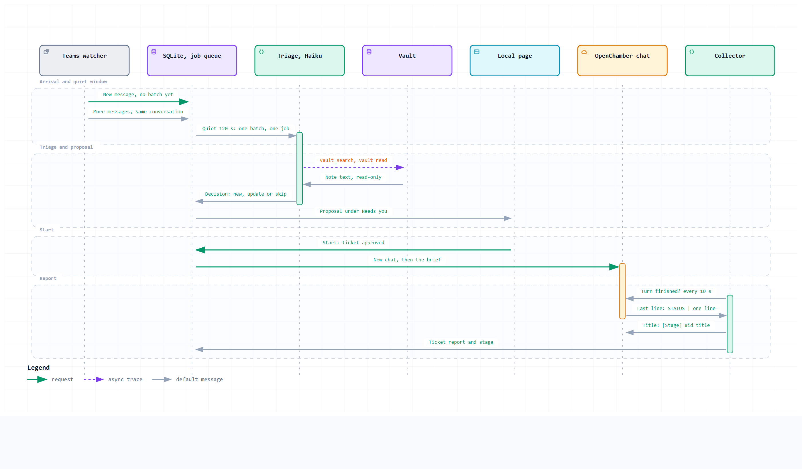

# Inbox dispatcher: from message to ticket and chat

How the inbox dispatcher collects mail and chat messages, proposes tickets on a local page, and runs an approved ticket in an OpenChamber chat.

## Overview

The dispatcher reads Outlook, Teams and the Teams relay, groups new messages by conversation, and asks a small model whether the group needs work. When it does, a ticket proposal appears on a local page. Nothing else happens until Start is pressed on that ticket.

Start opens one OpenChamber chat for the ticket and sends it a brief. The chat works under the normal rules of the assistant, and ends every turn with a STATUS line. The dispatcher reads that line back onto the ticket and into the chat title.

The dispatcher never sends anything. It has no mail or chat send transport, writes no read receipts, sends no auto-replies, changes no read state at the source, and never starts, focuses or closes a desktop app. Outward-facing text is approved inside the chat, never on the page.

## How the parts connect

Each watcher is a child process that prints one JSON line per message. The daemon stores the lines in SQLite, and every later step runs as a job from the queue in the same database. The page reads and writes the same database through its own local server.

## One message, from arrival to report

Time runs from top to bottom in four phases. A message waits without a batch until its conversation has been quiet for the window of its source, then all new messages of that conversation become one batch. The chat phase starts only after Start.

## Models and prompts

| Step | Model | Prompt | What the model sees |
|---|---|---|---|
| Triage | Haiku | `kb-agent.ts` lines 91 to 95 | The new messages of one conversation since it went quiet, its title, the inferred clients, the candidate tickets with title and summary, the ticket already linked, past Dismiss reasons, and Vault notes on request |
| Chat brief | Opus | `chat.ts` lines 48 to 53, 123 to 134 and 136 to 160 | The ticket fields, the note given at approval, and every stored message of the conversations linked to the ticket |
| New messages | Opus, same chat | `chat.ts` lines 180 to 186 | Only the new batches, plus own replies not yet sent to the chat |
| Recovery | Opus, same chat | `chat.ts` lines 465 to 472 | The error, the original request quoted, and own replies since then |

The files are in `src/dispatcher/`. Triage runs `claude-haiku-5-5` through the provider `meridian-everbright`, and through `meridian-notarify` when the first is unavailable. Its input is built in `kb-agent.ts` lines 322 to 325 and `tickets.ts` lines 297 to 305, and the Vault is reached only through the tools `vault_search` and `vault_read`. The chats run `meridian-everbright/claude-opus-5-5` through OpenChamber.

Triage does not read only the last message, and it does not read the whole history either. It reads the group of messages that arrived in that conversation since the last batch. The chat brief is the step that sees the whole stored history of the ticket.

Triage returns one JSON decision: `new`, `update` or `skip`, with title, client, summary, ask, proposal, Vault paths and a confidence. It attaches the batch to an existing ticket only with a confidence of 0.75 or more; below that the ticket becomes a new proposal with the old one as context. The prompts mark source messages and Vault notes as untrusted data.

## Sources

| Source | How it reads | How often | What it covers |
|---|---|---|---|
| Outlook | COM against a Classic Outlook that is already open. The new Outlook is not supported | Every 60 seconds | Inbox and Sent of every configured account, mail and meeting items, body up to 50,000 characters |
| Teams | HTTPS GET to the Teams chat service, with the tokens of the signed-in local Teams profile | Every 30 seconds | Every account found in the profile, all chats except system views such as call logs and notifications |
| Teams relay | `sqlite3 -readonly` over SSH on the relay host, nothing installed there | Every 30 seconds | Saved history of the active relay accounts of one owner, text up to 2,000 characters |

- Each scan reads back 2 minutes before the last checkpoint, so a message saved late is not lost.
- An expired Teams token is refreshed from the same profile. Teams is never restarted, and TLS is always verified.
- A line a watcher cannot parse goes to quarantine, and that source stops advancing until the line is replayed.
- A batch made only of own replies starts no triage. It is kept as context for the next chat turn of its ticket.

## Timings

All values are the defaults in `src/dispatcher/config.ts`; the running instance does not change them.

| What | Value |
|---|---|
| Quiet window before a batch | Outlook 300 s, Teams 120 s, relay 120 s |
| Scheduling and collect check | Every 10 s |
| Page refresh | Every 10 s |
| Sync of chat reports | Every 300 s |
| Archive of an idle chat | After 24 h without activity or pending input, checked every 300 s |
| Reopen of a done ticket by new messages | Within 14 days of closing |
| Purge of message text | After 30 days, skipped batches with no ticket only, once a day |
| Job lease | 120 s, renewed every 30 s |
| Retry backoff | 10 s doubling to 1,800 s, 20% jitter |
| Attempts before parking | 5, for unknown errors |
| Recovery turns per failed chat turn | 2 |
| Health shown as failing | After 3 errors in a row |
| Triage budget | 8 tool calls and 120 s, repair turn included |
| OpenChamber request timeout | 30 s |

## Rules

- Start approves a proposal. Open chat with note approves it too, and the note becomes the instruction quoted in the brief. Both need tickets and chats switched on.
- Approval creates one chat named `[Working] #<id> <title>`. After each turn the chat is renamed `[<stage>] #<id> <title>`, with the stage `Needs you`, `Working`, `Waiting on them`, `Idle`, `Done` or `Failed`.
- The last line of every turn must read `STATUS: <working|needs_you|waiting_them|blocked|done> | <one line>`. `done` closes the ticket. A turn without a valid STATUS line parks its job.
- Dismiss closes a ticket with an optional reason. The reasons are passed to every later triage.
- Make ticket turns a skipped or backlog batch into a ticket, or adds it to the ticket the conversation already belongs to. It does not approve the ticket.
- New messages on an approved ticket go to the same chat. If a turn is still running, they wait and go in the next turn.
- New messages on a ticket closed less than 14 days ago reopen it. Later messages make a new proposal with the old ticket as context.
- A failed chat turn gets a recovery turn that tells the chat to check sent items, pull requests and files before repeating anything. After 2 recoveries the ticket shows as Failed.
- A dependency error (timeout, refused connection, HTTP 408, 429 or 5xx, database busy) waits and retries without counting an attempt. A job error (HTTP 400 or 403, missing chat, invalid triage decision after one repair) parks at once. Any other error retries and parks on the fifth attempt.
- A parked job blocks later work on the same ticket until Retry is pressed. Sync, archive and purge never park.
- Triage tries the providers in order. A provider that fails on rate or availability is skipped until its backoff ends.

## Running it

The instance lives in `%LOCALAPPDATA%\inbox-dispatcher-v2`, built from commit `387d402`.

| File | Use |
|---|---|
| `start.ps1` | Starts the daemon, the watchers and the page |
| `stop.ps1` | Stops them; waits 15 s, then ends the owned processes. OpenChamber chats keep running |
| `status.ps1` | Shows whether the daemon runs, its process and port |
| `open-page.ps1` | Opens `http://127.0.0.1:8789/` |
| `config.toml` | The instance settings: tickets, chats and all three sources on, 60 minutes of catch-up at first start |

- There is no autostart, service or scheduled task. After a crash or a reboot the dispatcher stays down until `start.ps1` runs again.
- OpenChamber has to be running. The dispatcher reads its port and password from `~/.config/openchamber/settings.json`.
- The data is `dispatcher.db` in the same folder. The log is `dispatcher.db.log`, rotated at 10,485,760 bytes with 5 files kept. The Teams token cache and profile snapshots are in `dispatcher.db.sources`.
- The page listens on `127.0.0.1` only, and its buttons need the token of the current server start. After a restart the page has to be reloaded.
- The `config.toml` in the repository has every switch off and is not the running configuration.

## Known limits

- Outlook has not been checked live. Classic Outlook was closed during the live checks, so only the not-running error was seen.
- Outlook new-mail events are not supported by the COM bridge in use, so Outlook is polled.
- Google Chat is blocked on OAuth and has no watcher.
- One client tenant has no relay account, so the relay does not cover it.
- A chat creation still in flight when its job lease expires is not modeled. The 30 s request timeout is shorter than the 120 s lease.
- The `keywords` of each client in `config.toml` are read but not used anywhere.
